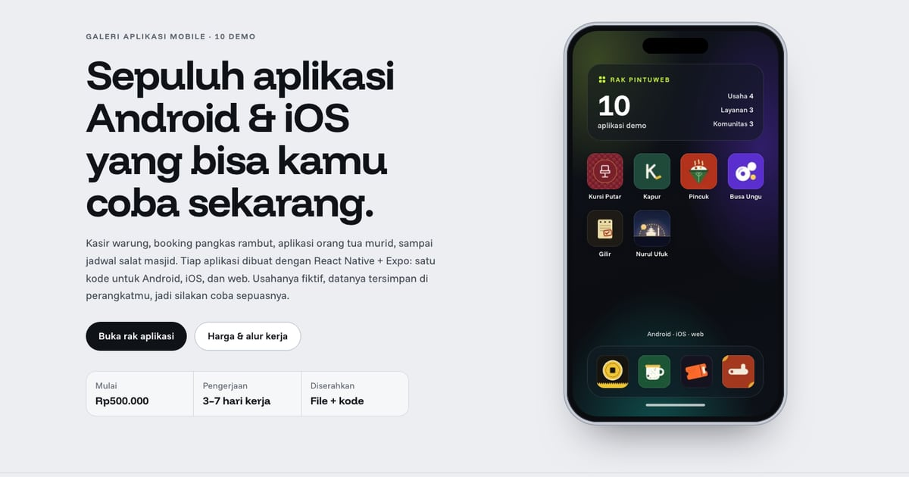

# PortalMobile — Rak Aplikasi

Galeri demo aplikasi mobile PintuWeb: sepuluh aplikasi Android & iOS (kasir warung, booking pangkas, orang tua murid, member kafe, pesan-antar, laundry, absensi, tiket acara, jemaah masjid, dan kos). Semua dibuat dengan React Native + Expo; yang dipajang di sini adalah versi web dari kode yang sama.

**Demo live:** https://www.pintuweb.id/aplikasi-mobile



> Katalog demo milik PintuWeb. Semua usaha di demo fiktif.

## Konsep

Bahasa layar ponsel. Pahlawan memuat layar beranda HP: widget, kisi ikon asli kesepuluh aplikasi, dan dok. Galeri berupa rak: tiap kartu punya panggung berwarna merek aplikasinya, dengan potret layar asli yang berdiri di atas rak kaca. Fitur ditulis sebagai widget bento yang menyebut aplikasi mana yang memilikinya, alur kerja sebagai tumpukan notifikasi di layar kunci, dan paket harga sebagai lembar info ala toko aplikasi. Rak bisa disaring menurut jenis usaha penggunanya (Toko & Kuliner, Jasa & Layanan, Pendidikan & Komunitas, Kantor & Properti, Acara & Hiburan) tanpa memuat ulang halaman, dan jumlah hasilnya diumumkan lewat aria-live; tanpa JavaScript semua kartu tetap tampil. Di ponsel ada strip demo yang bisa digeser, bilah aksi lengket (Lihat demo / Pesan via WhatsApp), dan menu "Galeri lain" di bilah jejak.

## Aplikasi yang dipamerkan (10)

- [Ketip](https://app-kasir.pintuweb.id) — kasir warung
- [Kursi Putar](https://app-booking.pintuweb.id) — booking pangkas & salon
- [Kapur](https://app-sekolah.pintuweb.id) — aplikasi orang tua murid
- [Kopi Blirik](https://app-member.pintuweb.id) — member & poin kafe
- [Pincuk](https://app-antar.pintuweb.id) — pesan-antar kuliner
- [Busa Ungu](https://app-laundry.pintuweb.id) — pelanggan laundry
- [Gilir](https://app-absensi.pintuweb.id) — absensi & HR karyawan
- [Karcis Wetan](https://app-tiket.pintuweb.id) — tiket acara
- [Nurul Ufuk](https://app-masjid.pintuweb.id) — aplikasi jemaah masjid
- [Grendel](https://app-kos.pintuweb.id) — aplikasi kos untuk penghuni dan pemilik

Ikon tiap aplikasi ada di `public/images/ikon/<slug>.webp` (dari `assets/icon.png` aplikasinya). Potret layar ada di `public/images/layar/<slug>-<n>.webp` (390×844, DPR 2, dipotret dari halaman live dengan `scripts/potret.mjs`). Varian WebP-nya dibuat `node scripts/static-images.mjs . --base /aplikasi-mobile`.

## Tautan langsung per demo

Tiap kartu punya `id` = slug demo: `kasir`, `booking`, `sekolah`, `member`, `antar`, `laundry`, `absensi`, `tiket`, `masjid`, `kos`. Contoh: https://www.pintuweb.id/aplikasi-mobile#antar. Halaman bergulir ke kartunya (memperhitungkan header lengket), menyorotnya sekitar 2 detik, dan mengembalikan saringan ke "Semua" bila kartunya sedang tersembunyi.

## Halaman

`/` (tayang sebagai `/aplikasi-mobile` di domain utama lewat basePath + rewrite PintuWeb) dan 404 bergaya. Akar dan path lain di portal-mobile.pintuweb.id dialihkan 308 ke https://www.pintuweb.id/aplikasi-mobile.

## Teknologi

- Next.js 15.5 (App Router) dan React 19, JavaScript
- Tailwind CSS v4
- Font: Funnel Display dan Funnel Sans (next/font)
- SEO: metadata, Open Graph, JSON-LD CollectionPage + ItemList + BreadcrumbList + FAQPage

Angka paket ada di `app/components/pintuweb.js` (PAKET, keputusan pemilik per 23 Oktober 2026). Kalau harga paket Aplikasi Mobile di PintuWeb berubah, ubah juga di sini.

## Menjalankan secara lokal

```bash
npm install
npm run dev
```

Buka http://localhost:3000/aplikasi-mobile. Untuk build produksi: `npm run build` lalu `npm start`.

---

Dibuat oleh [PintuWeb](https://www.pintuweb.id), jasa pembuatan website dan aplikasi.
